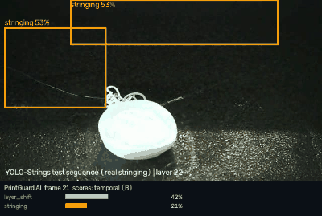
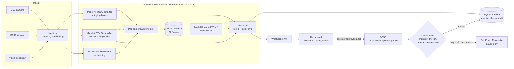

<div align="center">

# 🖨️ PrintGuard AI

**Real-time visual quality inspection for FFF 3D printing.**
A YOLO frame detector compared against a temporal model that catches *evolving* defects,
served by a FastAPI backend with a live operator dashboard and a printer-pause path that
**never acts without a human's approval**.

[](https://github.com/bileldh-ing/PrintGuard-/actions/workflows/ci.yml)


[](https://github.com/astral-sh/ruff)
[](LICENSE)



<sub>Replay of a <b>held-out test sequence</b> (YOLO-Strings, sequence 22) through the live server, using the CPU smoke-test weights.</sub>

</div>

---

## Why

Most hobby and small-shop print monitors look at one frame at a time. Many real failures don't
show up in one frame: a layer shift grows over several layers, stringing builds up across a
print. PrintGuard AI asks a concrete engineering question:

> **Does a temporal model over consecutive frames (Model B) detect evolving defects earlier, and
> with fewer false alarms, than a strong frame-level detector (Model A)?**

and wraps the answer in a deployable system: camera / RTSP / file ingestion → ONNX inference →
alerts → dashboard → *operator-approved* pause on OctoPrint or Moonraker (Klipper).

## Features

- **Model A – frame level.** Ultralytics YOLO box detector for `stringing` (YOLO-Strings) and a YOLO
  image classifier for `extrusion_error` / `layer_shift` / `no_error` (Trier FFF dataset).
- **Model B – temporal.** Causal **TCN** and small **Transformer** over per-frame feature vectors
  (Model A outputs + a frozen MobileNetV3-Small embedding), multi-label per time step.
- **Synthetic gradual layer shift.** Physically motivated augmentation (onset, ramp, max shift) that
  turns clean sequences into labelled evolving-defect sequences – real layer-shift *sequences* are
  not publicly available.
- **Leakage-safe data pipeline.** Resumable Zenodo download with CRC/MD5 checks, ranged reads of only
  the needed archive members, splits by **recording sequence / print block**, with an explicit leakage
  check that fails the build.
- **Sequence-level evaluation.** Frame AP / P / R *plus* what matters on a printer: detection rate per
  sequence, **detection delay**, and **false alarms per 100 frames / per print-hour**, using the same
  k-of-n alarm rule for both models.
- **Torch-free deployment path.** ONNX export of the Model A detector, classifier and feature embedder;
  the Docker image runs Model A on ONNX Runtime + OpenCV with no PyTorch. Model B can be exported too
  (`python -m printguard.export temporal`), but the live server still loads the PyTorch checkpoint;
  wiring the ONNX TCN into the server is on the roadmap.
- **Live system.** FastAPI REST + WebSocket, SQLite event timeline, single-page dashboard with live
  boxes, per-class confidence and trend, alert queue, pause audit log.
- **Safety first.** Pause is disabled by default, dry-run by default, requires an explicit operator
  approval of a specific alert, is rate-limited and audited. There is no automatic pause code path.
- **Engineering hygiene.** 52 unit/API tests, ruff lint + format, GitHub Actions CI on CPU, Makefile,
  Dockerfile + compose, typed configs with smoke / full profiles.

## Architecture



More detail – data flow, feature vector layout, threading model, safety state machine – in
[docs/architecture.md](docs/architecture.md).

## Quickstart

```bash
git clone https://github.com/bileldh-ing/PrintGuard-.git printguard && cd printguard
python -m venv .venv && source .venv/bin/activate

# runtime only (server + ONNX inference)
make install
# or the full training stack (CPU PyTorch wheel)
make install-train

make test                 # 52 tests, CPU only, ~1 min
make data                 # PROFILE=smoke: ~hundreds of MB from Zenodo, checksummed
make train-a              # Model A smoke run (CPU, minutes)  – use DEVICE=0 on a GPU
make train-b              # ONNX export + feature cache + TCN + Transformer
make eval                 # test-split metrics for A and B + CPU FPS benchmark
make demo && make serve   # replay a held-out test sequence → http://localhost:8000
```

Full-size training is meant for a GPU: open the Colab notebooks below, or run
`make data train-a train-b eval PROFILE=full DEVICE=0`.

**Docker (CPU, torch-free):**

```bash
docker compose up --build   # weights are mounted from ./weights, never baked into the image
```

### Makefile targets

| Target | What it does |
|---|---|
| `make help` | list all targets |
| `make install` / `install-train` | runtime deps / training deps (CPU torch wheel) |
| `make data` | download (CRC/MD5-checked) + prepare leakage-safe splits |
| `make train-a` | Model A: YOLO detector (YOLO-Strings) + frame classifier (Trier) |
| `make export` | ONNX export of Model A + feature embedder |
| `make train-b` | Model B: feature cache (resumable) + TCN + Transformer |
| `make eval` | test-split metrics for A and B + FPS benchmark |
| `make benchmark` | per-stage CPU latency / FPS |
| `make demo` | build a replay video from a held-out test sequence |
| `make serve` | API + dashboard on `http://localhost:8000` |
| `make test` / `lint` / `format` | pytest / ruff check + format check / auto-format |
| `make docker` | build and run with docker compose |

All targets take `PROFILE=smoke|full` (default `smoke`) and `DEVICE=cpu|0`.

### Notebooks

| Notebook | Purpose |
|---|---|
| [`notebooks/01_eda.ipynb`](notebooks/01_eda.ipynb) | class balance, cameras, image sizes, sequence lengths, sample grid |
| [`notebooks/02_train_model_a_colab.ipynb`](notebooks/02_train_model_a_colab.ipynb) | Colab GPU: clone → data → train detector + classifier → eval → ONNX |
| [`notebooks/03_train_model_b_colab.ipynb`](notebooks/03_train_model_b_colab.ipynb) | Colab GPU: Model A export → feature cache → TCN + Transformer → A vs B report |

## Datasets

| Dataset | Used for | Labels | License |
|---|---|---|---|
| **Trier FFF** – Bast et al. 2026 | Model A classifier; clean sequences for synthetic layer shift | image-level: extrusion error, layer shift, no error (+ stringing archive) | CC-BY-4.0 |
| **YOLO-Strings** – Charia et al. 2025 | Model A detector; real stringing *sequences* for Model B | YOLO boxes for stringing; per-print sequences | CC-BY-4.0 |

Nothing is redistributed in this repo; `make data` downloads from Zenodo and verifies checksums.
See [docs/data_card.md](docs/data_card.md) for splits, preprocessing and known biases.

> Bast, S., Scherer, K., Wahl, M., Naumann, S., Dartmann, G., Didas, S. (2026). *Quality Control in
> Additive Manufacturing: Image Dataset for Defect Detection in Fused Filament Fabrication* (v2.0.0).
> Zenodo. https://doi.org/10.5281/zenodo.18628777
>
> Charia, O., Rajani, H., Domingo-Espin, M., Ferrer Real, I., Gracias, N. (2025). *YOLO-Strings: A
> YOLO-compatible Dataset for Detecting Stringing during 3D Printing.* Zenodo.
> https://doi.org/10.5281/zenodo.14711320

## Evaluation methodology

- **Splits by print, not by image.** YOLO-Strings is split by recording sequence number (all cameras
  and augmented copies of a print stay together; test = sequences 5, 9, 22, 28). Trier frames are
  grouped into contiguous blocks that act as pseudo-prints; the official test archive stays the test
  set. `printguard.data.prepare` refuses to write splits if any group appears in two splits.
- **Model A:** detector – precision, recall, mAP@0.5, mAP@0.5:0.95; classifier – accuracy, macro-F1,
  per-class P/R/F1, confusion matrix.
- **Model A vs Model B on sequences:** both models score every frame of every test sequence; the same
  alarm rule (**3 of the last 5 frames above 0.5**) turns scores into alarms. Reported per class:
  frame AP / P / R, sequences detected, **median detection delay** (frames from defect onset to alarm),
  and **false alarms per 100 clean frames**. Per-print-hour figures are also produced but depend on an
  *assumed* seconds-per-frame, because the datasets do not publish layer times.
- **Latency:** per-stage and end-to-end median / p90 on CPU (`make benchmark`).

## Results

> ⚠️ **CPU smoke test — not final.** These numbers come from a 2-core CPU sandbox with tiny subsets,
> 1–3 epochs and reduced image sizes. They prove that the whole pipeline runs end to end and that the
> evaluation code produces honest numbers. They are **not** representative of what the models can do.
> Full GPU runs (Colab notebooks) are on the [roadmap](ROADMAP.md).

**Model A (frame level, test split)**

| Model | Training | Precision | Recall | mAP@0.5 | mAP@0.5:0.95 | Accuracy | Macro-F1 |
|---|---|---|---|---|---|---|---|
| Stringing detector (YOLO) | 1 epoch, 256 px | 0.060 | 0.308 | 0.046 | 0.009 | – | – |
| Frame classifier (YOLO-cls) | 3 epochs, 128 px | – | – | – | – | 0.532 | 0.517 |

**Model B (temporal TCN) vs Model A on test sequences** – alarm rule 3-of-5 above 0.5

| Defect | Metric | Model A (frame) | Model B (TCN) |
|---|---|---|---|
| Stringing (real sequences) | Frame AP | 0.385 | **0.965** ⚠️ |
| Layer shift (synthetic gradual) | Frame AP | 0.334 | **0.485** |
| Layer shift (synthetic gradual) | Sequences detected | 4 / 8 | 4 / 8 |
| Layer shift (synthetic gradual) | False alarms / 100 frames | 1.88 | **1.08** |

⚠️ **The stringing AP of 0.965 is very likely inflated by a scene shortcut.** In YOLO-Strings, stringing
and non-stringing sequences are different prints with different geometry and backgrounds, so a model
that sees 32 frames of context can partly learn *which print it is looking at* instead of *whether
strings are present*. Treat it as an upper bound until it is re-measured with scene-matched negatives
(see Limitations and Roadmap). The layer-shift comparison does not have this problem as strongly,
because the synthetic shift is applied to the same clean sequences that serve as negatives.

**Throughput:** the full per-frame pipeline (ONNX detector + ONNX classifier + ONNX embedder + PyTorch TCN) runs at **~13.8 FPS**
(72.6 ms median per 960×540 frame) on a 2-core CPU – far above the ~1 frame per layer a print monitor
needs. Raw JSON: [`results/smoke/`](results/smoke/).

## Safety

PrintGuard AI is **decision support**, not an autonomous controller.

- `printer.pause_enabled: false` and `dry_run: true` by default.
- There is **no code path that pauses automatically**. A pause request is only made from
  `POST /api/alerts/{id}/approve-pause`, which needs an operator name and a specific open alert.
- Each alert can be approved once; requests are rate-limited (`min_seconds_between_pauses`).
- Every attempt (success, failure, dry-run) is written to the audit log (`GET /api/pause-requests`).
- Only **pause** is implemented; resume / cancel stay manual at the printer.
- Printer API keys come from environment variables, never from config files or git. Mutating endpoints
  require `Authorization: Bearer $PRINTGUARD_TOKEN` when that variable is set.

## Limitations

- **Smoke-scale models.** Reported numbers are from minutes of CPU training; full training is pending.
- **Scene shortcut** in the stringing sequence task (above).
- **Synthetic layer shift.** Real gradual layer-shift video is not publicly available; the augmentation
  is a plausible approximation, not ground truth.
- **Taxonomy gaps.** `spaghetti` and `warping` are reserved classes with no public labelled data in the
  datasets used, so they are not detected yet.
- **Assumed timing.** Per-print-hour false-alarm rates rely on an assumed time per layer.
- **Domain shift.** Both datasets come from specific printers, cameras and lighting; expect a drop on a
  new setup until it is fine-tuned on own recordings.

## Ethics & responsible use

The datasets contain images of printed parts only, no people. When deploying on a shared printer
farm, cameras may capture people walking by: crop the field of view to the print bed, don't record
audio, and keep recordings local. Alerts can be wrong; the system is designed so a person stays in the
loop, and it should never be the only safeguard against fire or equipment damage. See the
[model card](MODEL_CARD.md) for intended and out-of-scope uses.

## Project layout

```
printguard/        library: data, models, training, inference, evaluation, export
server/            FastAPI app, ingestion, inference worker, SQLite timeline, printer guard
dashboard/         single-page operator UI (vanilla JS, WebSocket)
configs/           YAML configs (full + smoke profiles, server, docker)
tests/             pytest suite (CPU, no downloads)
notebooks/         EDA + Colab GPU training notebooks
results/smoke/     smoke-test metrics (JSON / Markdown / confusion matrix)
docs/              architecture, data card, Raspberry Pi guide, demo assets
```

## Roadmap

Highlights – full list in [ROADMAP.md](ROADMAP.md):

- [ ] Full GPU training of Model A and Model B (Colab notebooks) and updated results table
- [ ] Scene-matched negatives to remove the stringing shortcut
- [ ] Error-analysis gallery (false positives / negatives)
- [ ] Raspberry Pi 5 FPS measurement and ONNX Model B in the live server
- [ ] Own recordings on a real printer + camera, including spaghetti / warping

## Documentation

[Architecture](docs/architecture.md) · [Model card](MODEL_CARD.md) · [Data card](docs/data_card.md) ·
[Raspberry Pi guide](docs/raspberry_pi.md) · [Contributing](CONTRIBUTING.md) · [Roadmap](ROADMAP.md)

## Author

**Bilel Dhahri** – Software engineer (Engineering degree in Computer Science, ISSAT Sousse, 2026),
working on computer vision, robotics and IoT.
GitHub: [github.com/bileldh-ing](https://github.com/bileldh-ing)

## License

Code: [MIT](LICENSE). Datasets keep their own licenses (CC-BY-4.0); cite the original authors.
