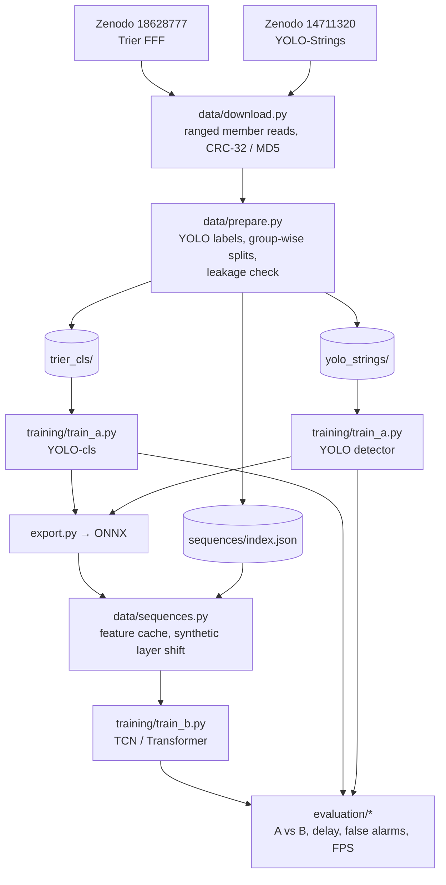
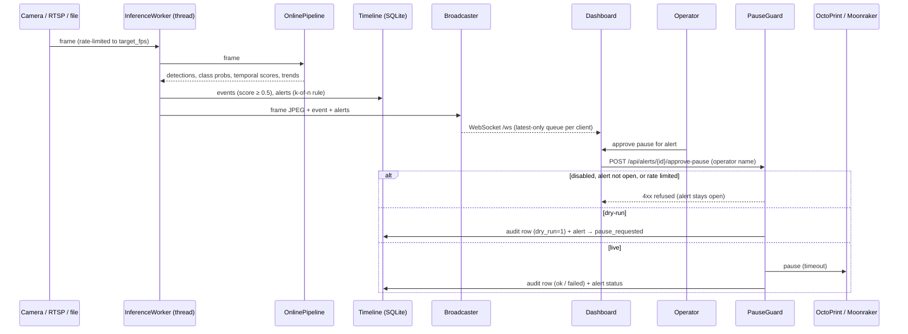
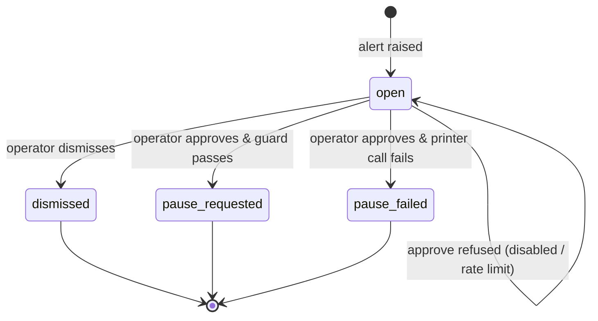

# Architecture

PrintGuard AI has two halves that share one library (`printguard/`):

1. an **offline pipeline** – download → prepare → train → export → evaluate – driven by `make`, and
2. an **online system** – ingestion → inference worker → alerts → API / dashboard → operator-approved pause.

## Offline pipeline

### Splits

| Dataset | Grouping unit | Rule |
|---|---|---|
| Trier FFF | contiguous frame block (pseudo-print; the archive has no print IDs) | official `test` archive = test; base blocks → train / val (20 %), stratified per class |
| YOLO-Strings | recording sequence number | val = sequences 17, 18, 20, 23, 25 (authors' own validation prints); test = 5, 9, 22, 28; FLIR + microscope views and Roboflow copies stay together |

`prepare.py` writes `splits.csv` and raises `RuntimeError("Leakage ...")` if any group appears in two
splits (tested in `tests/test_prepare.py`).

### Synthetic gradual layer shift

`printguard/data/augment.py` samples an onset (30–60 % into the sequence), a ramp length (8–25 frames)
and a maximum horizontal shift (3–8 % of the width). It estimates the row where new material is being
deposited and translates everything above it by a growing offset, producing per-frame labels that are
`0` before onset and `1` once the shift is visible. Clean sequences are reused as negatives, so the
comparison is not confounded by scene identity.

## Per-frame feature vector (Model B input)

| Block | Size | Source |
|---|---|---|
| Image embedding | 128 | frozen ImageNet MobileNetV3-Small, pooled 576-d → fixed random projection |
| Detector summary | 3 × detector classes | max confidence, box count (capped at 10, scaled), summed box-area fraction per class |
| Classifier probabilities | number of classifier classes | Model A classifier softmax |

Features are standardised with statistics fitted on the training split only (`FeatureNormalizer`).
Model B is **causal** (a prediction at time *t* only uses frames ≤ *t*), so it can run online.

## Online system

### Threading and shutdown

- The inference worker runs in a daemon thread; the FastAPI event loop owns the WebSocket clients.
  `Broadcaster` hands messages across with `loop.call_soon_threadsafe` and a bounded, latest-only
  queue per client, so a slow browser never blocks inference.
- `Timeline` wraps one SQLite connection with a lock. On shutdown (e.g. SIGTERM in Docker), the
  lifespan handler stops the worker first, then closes the timeline. Writes that arrive after close, or
  fail because the database became read-only during teardown, are logged and dropped instead of
  crashing (`tests/test_db_shutdown.py`).

### Alert policy

`printguard/inference/alerts.py`: an alert opens when *k* of the last *n* scores for a label exceed the
threshold (default 3 of 5 above 0.5 – the same rule as the offline metrics), then that label is muted
for `cooldown_frames`. Temporal scores are used when Model B is loaded, otherwise Model A scores.

### Pause safety state machine

Guard checks, in order: pausing enabled in config → alert exists and is still `open` → minimum time
since the last real pause → dry-run (record only) or real request with timeout. Every executed attempt
(dry-run, success or failure) is written to `pause_requests`; refused requests leave the alert open.

## API

| Method | Path | Purpose |
|---|---|---|
| GET | `/` | dashboard |
| GET | `/api/health` | liveness |
| GET | `/api/status` | worker, models, FPS, safety settings |
| POST | `/api/source` | start a `file` / `usb` / `rtsp` source |
| POST | `/api/source/stop` | stop the source |
| GET | `/api/events` | timeline events |
| GET | `/api/alerts` | alerts |
| POST | `/api/alerts/{id}/dismiss` | dismiss an alert |
| POST | `/api/alerts/{id}/approve-pause` | operator-approved pause (safety-gated) |
| GET | `/api/pause-requests` | audit log |
| GET | `/api/frame.jpg` | latest processed frame |
| WS | `/ws` | live frames, events, alerts |

Mutating endpoints require `Authorization: Bearer $PRINTGUARD_TOKEN` when that variable is set.
